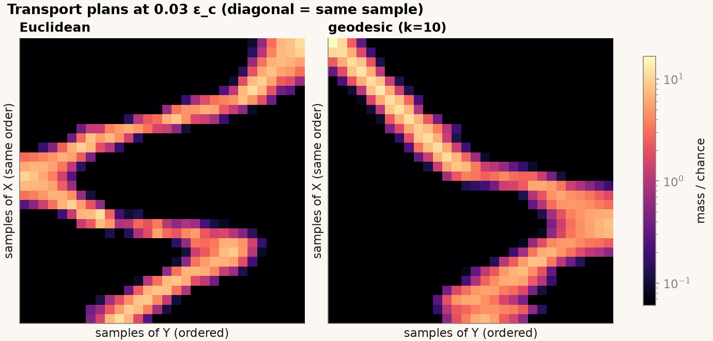

# latent-gw — comparing latent spaces with entropic Gromov–Wasserstein

<p align="center">
  
</p>

Do two latent spaces share a **shape**? The spaces can be embeddings of the same samples by two models, two brain regions or two modalities. Their axes need not match, and the comparison does not even need to know which sample is which.

`latent_gw` couples two point clouds with **entropic Gromov–Wasserstein (GW)**, which only looks at distances *within* each cloud. Around it, the package provides:
- distances that follow the data manifold: geodesic and Ollivier–Ricci, with discrete Ricci flow;
- the critical regularisation $\varepsilon_c$, computed from the spectra of the distance matrices, and a resolution parameter $\varepsilon/\varepsilon_c$;
- a normalised score $r$ and its decomposition;
- surrogates that keep the variance spectrum and destroy everything else, with an exact Monte-Carlo test;
- a test for expected pairs among many spaces.

The functions are taken unchanged from the research scripts that produced the results; `compare` chains them.

The repository has two parts:
- **`src/latent_gw/`** — the method, independent of any application, tested and documented.
- **`applications/champollion/`** — its application to the Champollion sulcal-region encoders (brain MRI).

> Research code from an internship at NeuroSpin (CEA), Brainomics team, 2026. No data is shipped.

---

## Why not just CKA, or a Euclidean comparison?

- **CKA, CCA and Procrustes need the pairing.** They compare sample *i* in space A with sample *i* in space B. GW does not, so it tests whether the geometry *alone* is shared, and whether it is enough to recover the pairing.
- **A raw GW score is not evidence of shared shape.** Two unrelated clouds with the same anisotropy already score high (see the quickstart). Comparing with **surrogates that keep the spectrum** shows what remains beyond it.
- **Latent spaces are rarely flat.** Distances along the manifold can reveal shared structure that straight-line distances blur.

---

## Install

```bash
python -m venv .venv && source .venv/bin/activate
pip install -e .                 # numpy, scipy, pandas, scikit-learn, joblib, torch (CPU or GPU), tqdm
pip install -e ".[figures,test]" # + matplotlib, imageio, POT (for the animation), pytest
# or, equivalently: pip install -r requirements.txt && pip install -e .
pytest -q                        # 12 tests, about 30 s on CPU
```

## Check your installation: the Swiss-roll toy

`python examples/toy_swiss_roll.py` takes about 10 s on CPU. It compares a Swiss roll with its unrolled version: the same 300 samples, with the same intrinsic coordinates, one rolled in 3-D and the other flat in 5-D with other axes. Straight-line distances cut across the layers of the roll; geodesic distances follow it. You should get:

```
euclidean                                      geodesic_k10
 rel    rA  rA_surr  contrast      z  ntrT      rel    rA  rA_surr  contrast      z  ntrT  top1
1.50 0.000    0.001    -0.000 -0.911 0.976     1.50 0.002    0.001     0.001 17.199 1.091 0.003
0.30 0.466    0.423     0.042  0.821 0.650     0.30 0.577    0.452     0.124 19.093 2.646 0.053
0.10 0.550    0.497     0.053  1.144 0.781     0.10 0.682    0.527     0.155 24.446 3.898 0.093
0.03 0.582    0.523     0.059  1.342 0.992     0.03 0.718    0.555     0.163 26.012 6.769 0.150
```

- **Euclidean:** the raw score looks decent ($r_A = 0.58$), but same-spectrum surrogates do almost as well ($z \approx 1$) and no sample is recovered ($n\cdot\mathrm{tr}(T) \approx 1$).
- **Geodesic:** the shared shape stands out beyond the spectrum ($z \approx 25$), and GW starts recovering samples (×6.8 over chance, 15 % exact matches at $0.03\,\varepsilon_c$).
- **The first row (1.5 $\varepsilon_c$) is a control:** its contrast must be ≈ 0. Its $z$ is meaningless there, because the surrogates barely differ from one another.

## Quickstart

```python
import latent_gw as lg

res = lg.compare(X, Y, metric="geodesic_k20", surrogate="pcperm", B=4)
```

`compare` runs, for one pair, exactly the computation of the Champollion maps, with a progress bar (`progress=False` to turn it off). `res` has one row per $\varepsilon/\varepsilon_c$ (default grid 1.5, 0.7, 0.3, 0.1, 0.03), with the following columns:
- `rA`, plus `r`, `r_ecc`, `r_diag`, `r_rest`, `r_off`: the GW score and its parts;
- `rA_surr`: the mean over surrogates of `X` that keep the spectrum;
- `contrast` $=$ `rA` $-$ `rA_surr`;
- `z` $=$ contrast $/(\mathrm{sd}\sqrt{1+1/B})$, and `c_<part>` / `z_<part>` for each part;
- `ntrT` $= n\cdot\mathrm{tr}(T)$, the mass kept on the same sample (×1 = chance), and `top1`;
- `c11`: the part of `rA` carried by the first pair of modes;
- `cka`: debiased linear CKA.

Metrics are named `euclidean`, `geodesic_k20`, `orc_k20` (one Ollivier–Ricci re-weighting) and `orc_k20_it3` (three steps of Ricci flow). Surrogates are `elliptic` (default in the maps script) or `pcperm`.

`python examples/quickstart.py` compares a cloud with a rotated, noisy copy of itself, and with an **unrelated cloud of the same spectrum** (8 pcperm surrogates, a few minutes on CPU):

```
related                                         unrelated, same spectrum
 rel    rA  rA_surr  contrast      z    ntrT     rel    rA  rA_surr  contrast     z  ntrT
1.50 0.000    0.000     0.000  1.551   1.003    1.50 0.000    0.000     0.000 1.548 1.000
0.30 0.541    0.502     0.039  3.724  16.016    0.30 0.490    0.489     0.001 0.068 1.026
0.10 0.944    0.770     0.174 52.543 147.882    0.10 0.768    0.764     0.004 0.529 1.174
0.03 0.991    0.837     0.154 68.407 197.335    0.03 0.835    0.835     0.000 0.050 1.832
```

How to read it:
- **Above $\varepsilon_c$, nothing is resolved** ($r_A = 0$).
- **Below $\varepsilon_c$, the unrelated cloud still reaches $r_A = 0.84$**, from its spectrum alone. Its surrogates do just as well, so its contrast and $z$ stay near 0, and it recovers no sample.
- **The related cloud stands far above its surrogates** ($z = 53$ at $0.1\,\varepsilon_c$) and recovers its samples up to ×197 over chance, without being told which is which.

---

## Figures

`latent_gw.plots` (needs `pip install -e ".[figures]"`) draws the figures used for the real analyses. Every function returns a matplotlib figure:
- `scores_vs_eps(results)`: $r_A$ of the real pair against its surrogates, and the contrast with its $z$, across $\varepsilon$;
- `retrieval_vs_eps(results)`: $n\cdot\mathrm{tr}(T)$ across $\varepsilon$;
- `transport_plans_figure(plans, order)`: plans pooled in blocks of samples, ordered along the manifold (`spectral_order`), computed with `transport_plans(X, Y, metric)`;
- `spectra(clouds)`: variance spectra;
- `score_matrix(M)`: e.g. the CKA matrix from `cka_matrix`.

`python examples/toy_plots.py` draws all of them on the Swiss-roll toy in about 20 s and writes them to `toy_figures/`. The geodesic plan follows one continuous band (each sample goes to its neighbourhood on the sheet); the Euclidean plan zigzags, because straight-line distances confuse the layers of the roll.

<p align="center"></p>

---

## CKA between many spaces

`latent_gw.cka_map` computes the debiased linear CKA for every pair of spaces in a folder of `.npy` files, with the same subsample and preprocessing as the GW maps. With `--homologues`, it also tests pairs named `<base>_left` / `<base>_right`:

```bash
python -m latent_gw.cka_map --inputs path/to/aligned --out out/cka --homologues
```

It writes `cka_pairs.csv`, `cka_matrix.csv`, `cka_homologues.csv` (CKA and residual per homologue pair) and `cka_test.txt`: the mean CKA of the homologues vs. random left/right re-pairings, and a sign test. Every space must list the same samples in the same order. From Python: `lg.cka_matrix(dict_of_arrays)`.

---

## The method in brief

| Step | Module (origin) | |
|---|---|---|
| Preprocess | `preprocessing` (178) | Optional L2 normalisation of the points (centre, unit norm); distances rescaled so that $\operatorname{mean}(D^2)=1$. The same pipeline is applied to real clouds and to surrogates. |
| Graphs | `graphs` (synth_graph_metrics) | Symmetric kNN graph with Euclidean edge weights; if disconnected, $k$ is increased up to $2k+40$, then components are bridged by a minimum spanning tree on their centroids. All-pairs shortest paths. |
| Curvature | `curvature` (ricci_flow) | Ollivier–Ricci curvature with lazy measures $m_i=\tfrac12\delta_i+\tfrac1{2k}\sum_{N_k(i)}\delta$, exact $W_1$. Edge weights $w\leftarrow d\,(1-\eta\kappa)$, renormalised; iterating gives a discrete Ricci flow. |
| Distances | `distances` (178) | `dist_from_emb(X, metric, l2=...)` chains the three steps above. |
| Solver | `solver` (178, 199) | `describe` computes $\rho$, eccentricities $e$, $A=JDJ$ and its extreme eigenvalues. $\varepsilon_c = 4\max(\lambda^+_X\lambda^+_Y,\ \lambda^-_X\lambda^-_Y)$: above it, the plan is the product coupling. `gw_solve` is entropic GW (POT convention) with a log-domain Sinkhorn inner loop on CPU or GPU. `solve` (199) is the same solver, also returning the contraction rate. `run_path` solves at $\varepsilon=c\,\varepsilon_c$, largest first, each plan warm-starting the next. |
| Scores | `scores` (178) | $r = r_\text{ecc} + r_A$: the GW-cost gain of $T$ over the product coupling, divided by $\sigma_X\sigma_Y$. $r_A=\langle A_X, TA_YT^\top\rangle/(\sigma_X\sigma_Y)$ and $r_\text{ecc}=2e_X^\top Te_Y/(\sigma_X\sigma_Y)$. Also $n\cdot\mathrm{tr}(T)$, top-1 retrieval, and `ceiling`: the largest $r$ any coupling can reach, given the spectra alone. |
| Surrogates | `surrogates` (178) | `native`: random Haar rotation in sample space, exactly the same covariance. `elliptic`: native with the original norms. `spectral` / `spectral_ecc`: from $D$ alone, for any metric. `pcperm` (215): PCA scores permuted independently per component. |
| Tests | `inference` (178, 224) | `mc_test`: $z$, rank $p$ per $\varepsilon$, and $p$ of the max over $\varepsilon$ (exact under exchangeability). `pairing_tests`: $n\cdot\mathrm{tr}(T)$ and Mantel against permutations. `pair_test`: expected pairs among many spaces (baseline, residuals, re-pairings, sign test). |
| Per pair | `compare` (215) | `prep_region` (distances, descriptors, leading eigenpair), `path` (continuation from the slightly tilted product coupling), and `compare`: contrast and $z$ against surrogates. |
| Baseline | `cka`, `cka_map` (215) | Debiased linear CKA (`cka_u`), which uses the pairing; plain `linear_cka`. `cka_map`: all pairs of spaces at once, plus the homologue test. |

## Layout

```
src/latent_gw/          the method (no application code)
tests/                  unit tests (r = scaled GW-cost gain, metrics, surrogates, shape vs spectrum, pair test)
examples/               toy_swiss_roll.py (installation check), toy_plots.py (figures), quickstart.py, gw_clusters_gif.py (the animation above)
applications/champollion/   application to Champollion sulcal regions, see its README
assets/                 README figures
```

## Practical notes

- **float64 throughout.** The solver works in float64 (CPU or GPU); float32 can produce NaNs at small $\varepsilon$.
- **Cost.** Dense GW is $O(n^2)$ in memory and roughly $O(n^3)$ per iteration. A few thousand points per cloud is the practical range on CPU; beyond that, subsample.
- **Check kNN-graph connectivity** at the sample size you actually use.
- **Negative Ollivier–Ricci curvature is generic in high dimension;** it is not a finding by itself.
- **Restricted data:** when inputs are subject-level, distance matrices and transport plans are subject-level too. Keep them on the authorised infrastructure, export only aggregates, and show plans pooled in blocks of samples.

---

Thomas Lambelin — NeuroSpin (CEA), Brainomics team, GAIA lab — supervised by Vincent Frouin and Jean-Christophe Aude. Built on PyTorch, SciPy and scikit-learn; the animation uses [POT](https://pythonot.github.io/).
